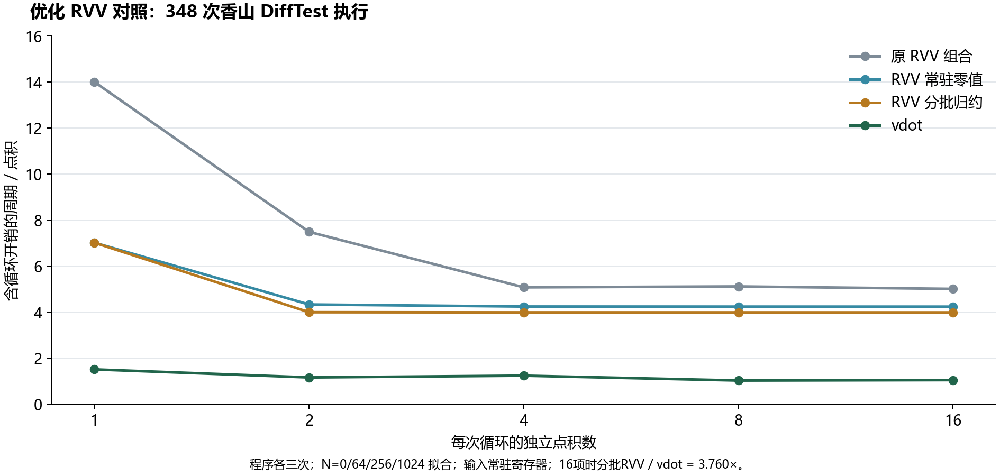
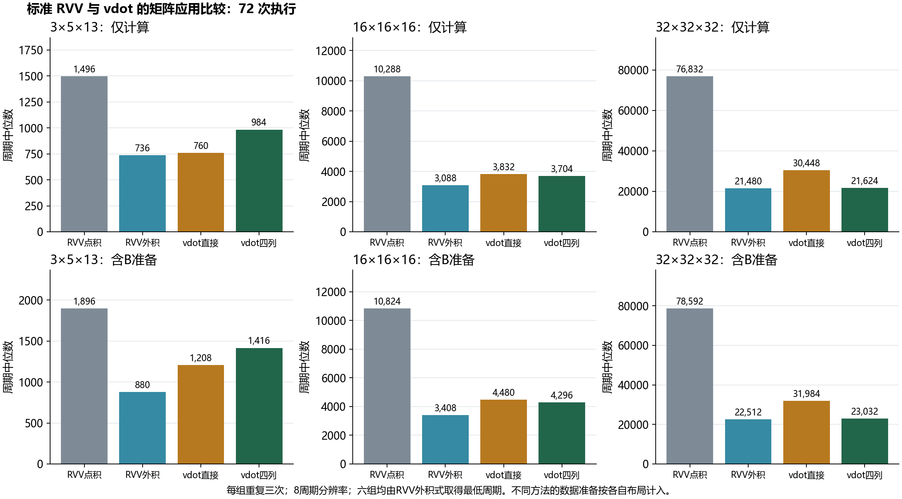
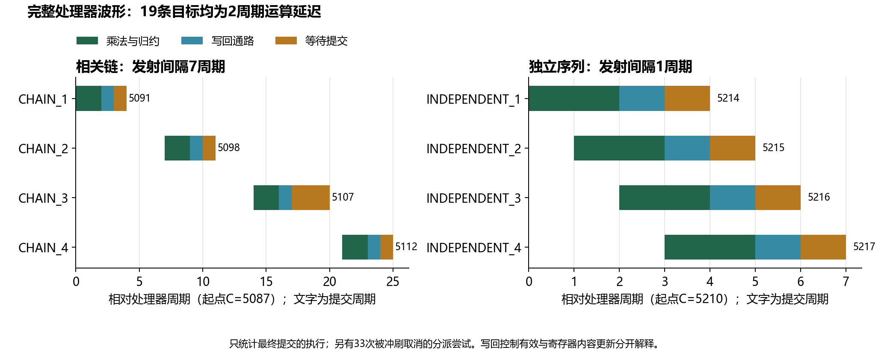
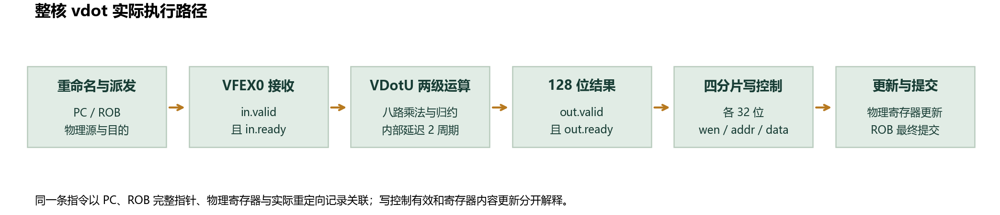

# 当前性能结果与图表

更新：2026-11-04。本次348次优化点积与72次GEMM均完成DiffTest并在下载后复算。主结论：16项独立点积相对分批RVV为3.760303倍；依赖链相对较快的原RVV为2.995397倍。GEMM六组均由标准RVV外积式更快，当前不能声称矩阵或LLM整体加速。

数据来源为[当前点积](../experiments/throughput/measured_20261103/README.md)、[当前GEMM](../applications/gemm/measured_20261103/README.md)、[整核波形](../results/vdot_full_core_20261102/README.md)。

从相关证明材料执行 `python -B scripts/check_measurements.py --out ../current-check-new`，成功标记为420条、140组、每组三次。`python -B performance/build_figures.py`覆盖当前PNG/SVG/PDF图。

[build_figures.py](build_figures.py) 生成当前点积比较、矩阵比较、vdot 流水时序及整核路径四组图，每组输出 PNG、SVG 和 PDF；可用 `--out` 指定输出目录，默认保存到本目录的 `figures/`。
