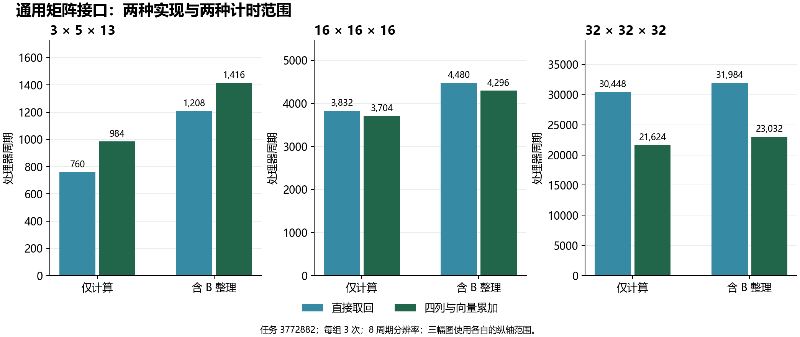
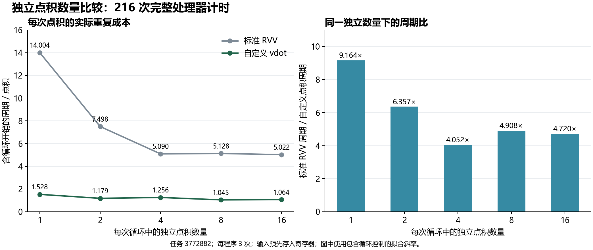

# 性能结果与图表

更新：2026年10月26日。任务3772882的252次完整处理器计时已完成：通用矩阵接口36次、独立点积216次，全部通过，每个程序三次重复。

## 通用矩阵接口



图中数据来自[12组实际结果](../applications/gemm/measured_20261026/summary.csv)。两种方法均实际执行自定义点积，调用方法和数据布局见[矩阵接口说明](../applications/gemm/README.md)。计时区间分别为仅计算、含B整理；它们由不同程序分别测量，不能把两区间差值直接解释为独立的数据整理成本。

| 尺寸 M×N×K | 仅计算：直接取回 | 仅计算：四列方法 | 含B整理：直接取回 | 含B整理：四列方法 |
| --- | ---: | ---: | ---: | ---: |
| 3×5×13 | 760 | 984 | 1,208 | 1,416 |
| 16×16×16 | 3,832 | 3,704 | 4,480 | 4,296 |
| 32×32×32 | 30,448 | 21,624 | 31,984 | 23,032 |

单位为处理器周期。每组均有三次成功读数，表中为中位数；分辨率8周期，每个整数C表示实际周期位于C至C+7。三次量化记录均相同。

32方阵含B整理时，四列方法相对直接取回减少约28.0%周期；仅计算时减少约29.0%。小尺寸3×5×13反而是直接取回较快。这里只比较通用接口内部两种方法，没有标准RVV的矩阵应用对照。启动和最终结果校验在计时区间之外。

## 独立点积数量比较



图中使用包含循环开销的斜率，来源为[周期比较](../experiments/throughput/measured_20261026/analysis/comparison.csv)和[倍率表](../experiments/throughput/measured_20261026/analysis/speedup.csv)。

| 每次循环的独立点积数 | 标准RVV周期/点积 | 自定义点积周期/点积 | 周期比 |
| --- | ---: | ---: | ---: |
| 1 | 14.004032 | 1.528226 | 9.164 |
| 2 | 7.497984 | 1.179435 | 6.357 |
| 4 | 5.089718 | 1.256048 | 4.052 |
| 8 | 5.128024 | 1.044859 | 4.908 |
| 16 | 5.022429 | 1.064012 | 4.720 |

72个程序各三次，共216次；循环次数为0、64、256、1024。输入预先存于寄存器，结果描述重复计算，不包含每次重新装载输入的应用成本。依赖链参照为20.991935对7.008065周期/点积，周期比2.995。

本批8个独立点积时的自定义指令含循环值最低。曲线并非单调变化，不能仅据这些点认定达到硬件理论极限。扣除空循环后的估计另表保存；乱序执行可能使计算和控制重叠，因此主结论继续采用含循环数值。

## 重算与重新生成图

从“相关证明材料”目录执行：

```text
python -B scripts/check_measurements.py --out ../measured-check-new
python -m pip install -r performance/requirements.txt
python -B performance/build_figures.py
```

第一条重算随附252条结果。图表工具读取上述实际统计表，生成当前两幅图的PNG、SVG和PDF，成功输出为 `FIGURES_PASS images=2 formats=3`。

任务与资源见[完成记录](../measurements/20261026/README.md)。规范参考：[RISC-V向量扩展](https://docs.riscv.org/reference/isa/unpriv/v-st-ext)、[DiffTest官方工程](https://github.com/OpenXiangShan/difftest)。
